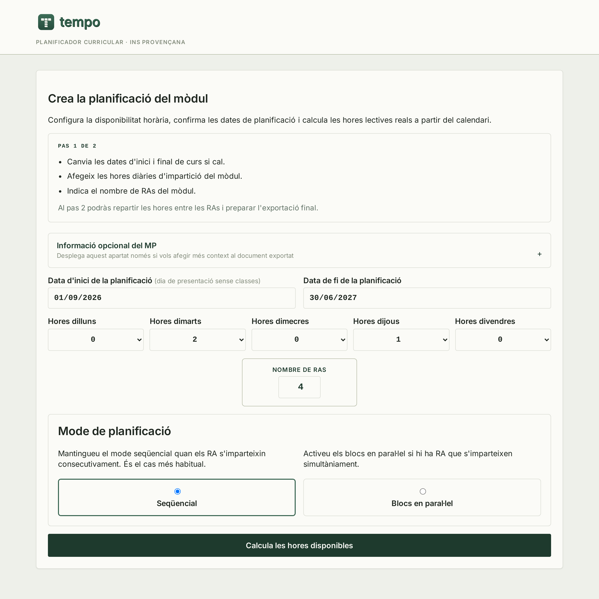
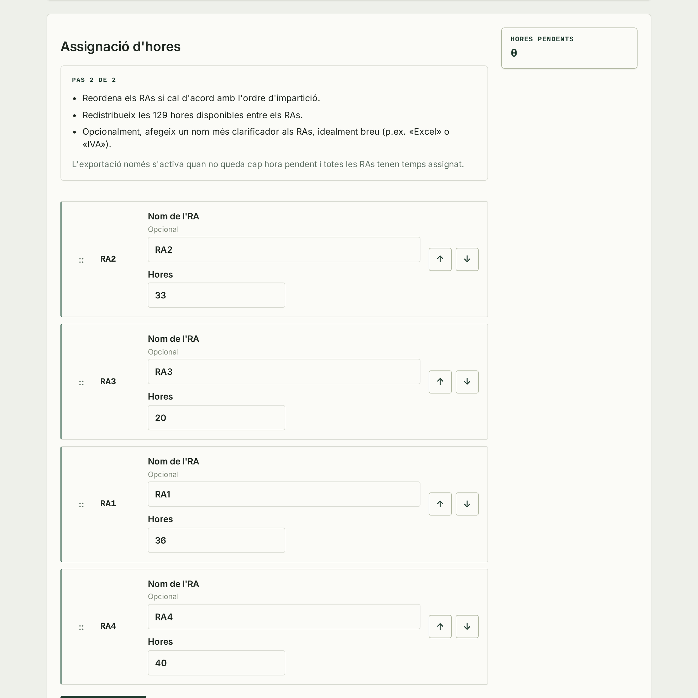
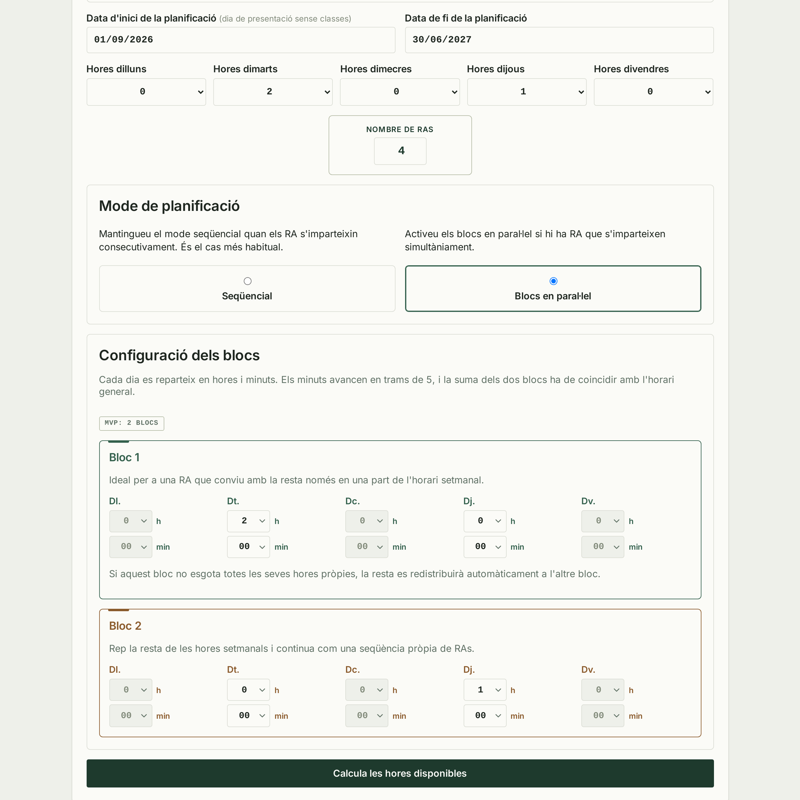
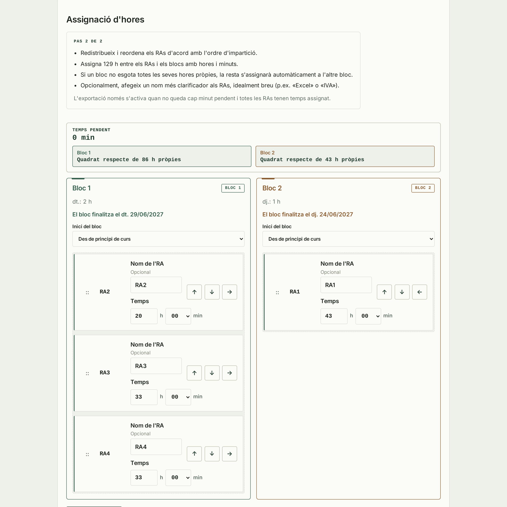

[Llegiu-lo en català](README.md)

<p align="center">
  
</p>

<p align="center">
  <strong>Compact curriculum planner for distributing teaching hours, excluding no-class dates, and exporting the final plan as XLSX.</strong>
</p>

## Tempo

Tempo is a small FastAPI application built to help schools and teachers plan a module across an academic year with clarity and very little operational noise. The project stays intentionally compact: most business rules live in `app/services/`, HTTP routes in `app/routes/`, and the interface in `app/templates/`.

## Development Note

This project was developed with human direction and review, with AI assistance used for parts of the implementation, refactoring, and deployment-flow documentation. Final product decisions and responsibility for the deployed result remain with the project owner.

## What It Does

- defines a teaching calendar from real class days
- excludes no-class periods and blocked dates from the admin area
- distributes learning outcomes sequentially or in parallel blocks
- lets teachers review the distribution before export
- exports the final planning workbook as XLSX for manual review
- builds a student's internship calendar (end date, days without internship and per-day adjustments) and exports it as an editable XLSX that recalculates itself

## Visual Walkthrough

Tempo keeps the usual journey to two decisions and one exportable result. The screenshots below follow the sequential mode, which is the most common path.

### 1. Configure The Module

Set the dates, weekly teaching hours, and number of learning outcomes. This is also where the planning mode is selected.



### 2. Allocate The Available Hours

Tempo calculates the real teaching hours after removing no-class periods, so teachers can order the learning outcomes, allocate their time, and confirm that nothing remains before export.



### 3. Review The Exported Workbook

Once the distribution is complete, the application generates an XLSX workbook ready for review and manual adjustment.


### Parallel Blocks Mode

When learning outcomes are taught at the same time, weekly hours can be split into two independent blocks and distributed with minute-level control.



In the second step, learning outcomes can be assigned, reordered, and validated within each block before the XLSX workbook is generated.



The entry screen is also available at [docs/screenshots/tempo-step-1-landing_page.png](docs/screenshots/tempo-step-1-landing_page.png). The remaining screenshots, including a second view of the exported workbook, live in [docs/screenshots/](docs/screenshots/) for more detailed documentation.

## Internship Calendar

The `/practiques` section is independent from module planning and works out when a student's internship ends.

### In The App

- **Inputs:** start date, total hours (minutes supported), hours for each weekday and, optionally, the student and company details shown in the exported sheet header.
- **Days without internship:** the school calendar's periods are pre-selected and can be unticked when they do not affect the company (e.g. an internship that runs through school holidays). Other days can be added too, such as the company's local holidays or holidays after classes end.
- **Live calendar:** shows the end date, planned hours and internship days. The last day only receives the hours still needed.
- **Per-day adjustments:** clicking any day changes its hours, including setting it to 0 or adding hours on a holiday or weekend. Removing hours moves the end date later, and the calendar adds the months it needs on its own.
- The form is kept in the browser between visits.

### Exported XLSX

- **Calendar:** one grid per month, from the start month to the month after the end date, so hours can be added past the planned end.
- **Hours as `h:mm`:** each day is typed as `4:30`; cells only accept values between `0:00` and `12:00`, so `4` or `4,5` are rejected with a message.
- **Totals as `4h30`:** weekly, monthly, planned and remaining hours recalculate when any day is edited, as does the end date.
- **Automatic colours:** days with hours are green and days without internship (`0`, shown as `-`) are red. "Hores planificades" and "Hores restants" turn red until the target is met.
- **Instructions** in the top right corner and **sheet protection** without a password: only real days' hours and the header details can be edited.
- The **Detall** sheet (one day per row with running and remaining totals) and the **Configuració** sheet (schedule and applied days without internship) complete the workbook.

## Visual Assets

- `design/brand/` holds the master brand and logo assets
- `docs/screenshots/` holds documentation-ready screenshots
- [docs/screenshots/README.md](docs/screenshots/README.md) explains the purpose and maintenance of each screenshot

## Stack

- FastAPI
- Jinja templates and lightweight JavaScript
- SQLite
- SQLAlchemy
- openpyxl
- Docker Compose

## Local Development

`docker-compose.yml` is set up for local development:

- `./app` and `./tests` are bind-mounted into the container
- Uvicorn runs with `--reload`
- the SQLite database is stored in `./data/app.db`

Steps:

1. Copy `.env.example` to your own `.env` file if you want custom values.
2. Start the app:

```bash
docker compose up --build
```

3. Open `http://localhost:8000`
4. The teacher flow is available at `/`
5. The admin area is available at `/admin`

If port `8000` is already busy:

```bash
HOST_PORT=10080 docker compose up --build
```

## Production-Style Deployment

Use `docker-compose.production.yml` when you want a reproducible container run without bind mounts or `--reload`.

```bash
ENV_FILE=/absolute/path/to/.env.prod DATA_DIR=/absolute/path/to/data HOST_PORT=8091 docker compose -f docker-compose.production.yml up -d --build
```

You can also use the repository helper script:

```bash
ENV_FILE=/absolute/path/to/.env.prod DATA_DIR=/absolute/path/to/data HOST_PORT=8091 bash scripts/deploy_production.sh
```

For branch preview deployments:

```bash
bash scripts/deploy_preview.sh
```

## Application Flow

### Teacher Flow

- `/` shows the initial module configuration form
- `/plan` lets users sort, distribute, and validate learning outcomes before export
- the final export is generated as an XLSX workbook
- `/practiques` computes an internship calendar from a start date, total hours and a weekly schedule (minutes supported), reuses the configured non-teaching periods, lets users adjust any day's hours and exports an editable XLSX (see [Internship Calendar](#internship-calendar))

### Admin Flow

- `/admin` is authentication-protected
- it manages academic years and excluded dates
- it is not linked from the public UI

## Main Environment Variables

- `APP_NAME`: main product name shown in the UI
- `SCHOOL_NAME`: optional suffix in the title and header
- `SECRET_KEY`: session signing secret
- `ADMIN_USERNAME`: admin username
- `ADMIN_PASSWORD`: admin password
- `DATABASE_URL`: SQLAlchemy connection URL
- `WEB_CONCURRENCY`: process count for the production-style server runtime

## Tests

To run the main test suite:

```bash
docker compose run --rm web pytest
```

To run the focused service tests directly:

```bash
pytest tests/test_services.py
```

## Project Structure

```text
app/
  routes/
  services/
  static/
  templates/
design/
  brand/
docs/
  screenshots/
scripts/
tests/
README.md
README.en.md
```

## Brand And Design Resources

- `design/tempo-design-system.md`: canonical visual-system reference
- `design/brand/README.md`: correct logo usage and variants
- `design/brand/build_svgs.py`: generates every logo SVG from the design-system values (`--check` reports drift)
- `app/static/img/`: curated subset of logo assets served by the app

## License

This project is licensed under `AGPL-3.0-only`. See [LICENSE](LICENSE).
