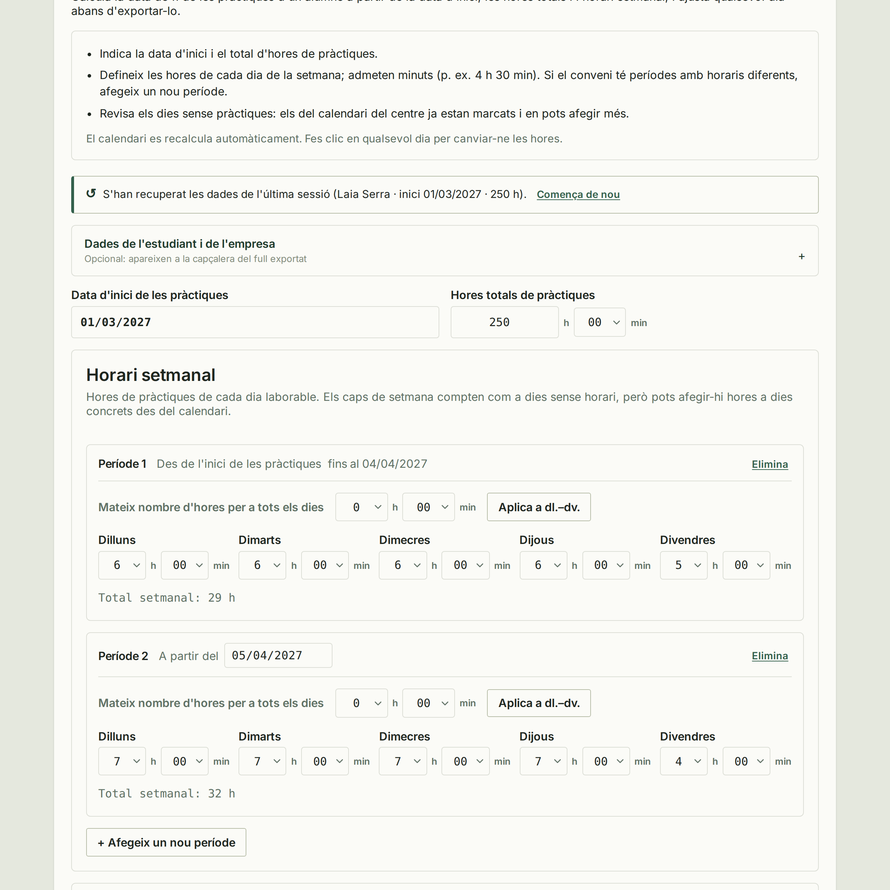
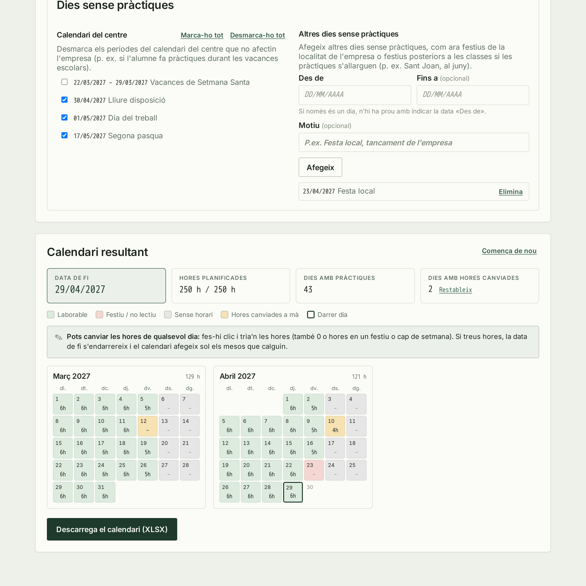
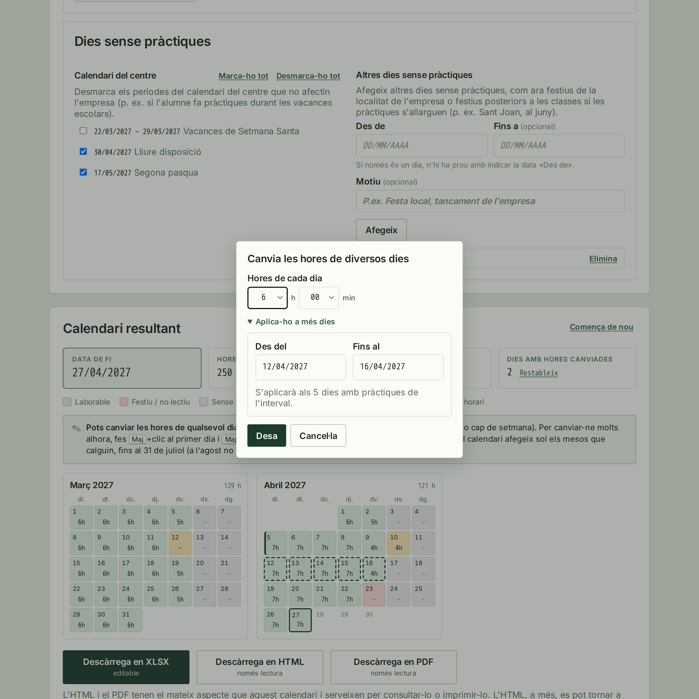

[Llegiu-lo en català](README.md)

<p align="center">
  
</p>

<p align="center">
  <strong>Compact curriculum planner for distributing teaching hours and exporting the plan as XLSX, with an internship hours planner for working out students' internship calendars.</strong>
</p>

## Contents

- [What It Does](#what-it-does)
- [Curriculum Planner](#curriculum-planner): distribute a module's hours across its learning outcomes
- [Internship Hours Planner](#internship-hours-planner): work out when a student's internship ends
- [Visual Assets](#visual-assets)
- [Stack](#stack)
- [Local Development](#local-development)
- [Production-Style Deployment](#production-style-deployment)
- [Application Flow](#application-flow)
- [Main Environment Variables](#main-environment-variables)
- [Tests](#tests)
- [Project Structure](#project-structure)
- [Brand And Design Resources](#brand-and-design-resources)
- [License](#license)

## Tempo

Tempo is a small FastAPI application built to help schools and teachers plan a module across an academic year with clarity and very little operational noise. The project stays intentionally compact: most business rules live in `app/services/`, HTTP routes in `app/routes/`, and the interface in `app/templates/`.

## Development Note

This project was developed with human direction and review, with AI assistance used for parts of the implementation, refactoring, and deployment-flow documentation. Final product decisions and responsibility for the deployed result remain with the project owner.

## What It Does

Tempo has two tools, both reachable from the app header.

**[Curriculum Planner](#curriculum-planner)** (`/`)

- defines a teaching calendar from real class days
- excludes no-class periods and blocked dates from the admin area
- distributes learning outcomes sequentially or in parallel blocks
- lets teachers review the distribution before export
- exports the final planning workbook as XLSX for manual review

**[Internship Hours Planner](#internship-hours-planner)** (`/practiques`)

- works out a student's internship end date from a start date, total hours and a weekly schedule, which can change between the agreement's periods
- skips the school calendar's days without internship and lets users add others
- lets users adjust any day's hours directly on the calendar
- exports it as an editable XLSX that recalculates itself, or as a read-only HTML or PDF copy that looks like the web version

## Curriculum Planner

Tempo keeps the usual journey to two decisions and one exportable result. The screenshots below follow the sequential mode, which is the most common path.

### 1. Configure The Module

Set the dates, weekly teaching hours, and number of learning outcomes. This is also where the planning mode is selected.


### 2. Allocate The Available Hours

Tempo calculates the real teaching hours after removing no-class periods, so teachers can order the learning outcomes, allocate their time, and confirm that nothing remains before export.


### 3. Review The Exported Workbook

Once the distribution is complete, the application generates an XLSX workbook ready for review and manual adjustment.


### Parallel Blocks Mode

When learning outcomes are taught at the same time, weekly hours can be split into two independent blocks and distributed with minute-level control.


In the second step, learning outcomes can be assigned, reordered, and validated within each block before the XLSX workbook is generated.


The entry screen is also available at [docs/screenshots/tempo-step-1-landing_page.png](docs/screenshots/tempo-step-1-landing_page.png). The remaining screenshots, including a second view of the exported workbook, live in [docs/screenshots/](docs/screenshots/) for more detailed documentation.

## Internship Hours Planner

The `/practiques` section is independent from module planning and works out when a student's internship ends.

### 1. Set Up The Internship

Enter the start date, total hours (minutes supported) and the hours for each weekday. If the agreement has periods with different schedules (e.g. shorter summer hours), add a new period and set the date it applies from. Optionally, add the student and company details shown in the header of the exported files (XLSX, HTML and PDF). The form is kept in the browser between visits.



### 2. Review Days Without Internship And The Calendar

The school calendar's periods are pre-selected and can be unticked when they do not affect the company (e.g. an internship that runs through school holidays). Other days can be added too, such as the company's local holidays or holidays after classes end. If the internship runs past the non-teaching days configured in the school calendar, a warning in this same section reminds users to add the later holidays. The calendar recalculates live and shows the end date, planned hours and internship days; the last day only receives the hours still needed. When there are several periods, the first day of each one is marked on the calendar.



### 3. Adjust A Day's Hours

Clicking any day changes its hours, including setting it to 0 or adding hours on a holiday or weekend. Removing hours moves the end date later, and the calendar adds the months it needs on its own.

To change many days at once (e.g. from 20 October to 10 November), Shift+click the first day (it is marked without opening any dialog) and Shift+click the last one, or open "Aplica-ho a més dies" in the day's dialog. This option, folded away by default, asks for a date range and the weekdays it applies to (by default, those with hours in the schedule), shows how many days will change and highlights them on the calendar. Days without internship inside the range (holidays and non-teaching periods) are left alone. Each day is stored as an individual change, so it can be adjusted or reset like any other.

Internships cannot run in August, so the calendar never goes past 31 July of the school year it starts in. If the hours do not fit, the app warns and shows the hours still pending, which need a new agreement next school year.



### Exported XLSX

- **Calendar:** one grid per month, from the start month to the month after the end date (31 July at the latest), so hours can be added past the planned end. If hours are still missing in July, the sheet says so.
- **Hours as `h:mm`:** each day is typed as `4:30`; cells only accept values between `0:00` and `12:00`, so `4` or `4,5` are rejected with a message.
- **Totals as `4h30`:** weekly, monthly, planned and remaining hours recalculate when any day is edited, as does the end date.
- **Automatic colours:** days with hours are green and days without internship (`0`, shown as `-`) are red. "Hores planificades" and "Hores restants" turn red until the target is met.
- **Instructions** in the top right corner and **sheet protection** without a password: only real days' hours and the header details can be edited.
- The **Detall** sheet (one day per row with running and remaining totals) and the **Configuració** sheet (each period's schedule with its dates, and the applied days without internship) complete the workbook.

### Read-Only HTML Copy

The "Descàrrega en HTML" (read-only) button produces a single `.html` file that looks like the web calendar: the summary, the legend, the month grids (with each day's details on hover), the weekly schedule and the applied days without internship. The header groups the details in columns: the student (name, training cycle and group), the company (name, tutor and tutor's email) and the dates (start date and total hours); empty fields and columns with no details are left out. The stylesheet, font and logo are embedded, so it opens offline in any browser and prints or saves to PDF directly.

The file cannot be edited and runs no scripts. Before downloading it, a dialog asks users to check the calendar is correct. The form's data stays in the browser, so fixing it only takes going back to `/practiques` in the same browser and downloading it again.

The file also carries the calculation's data in an inert JSON block (`#tempo-internship-plan`): the form's inputs (including the student and company details), the date it was saved and the result it gave. That is why it can be opened again from any browser with the "Obre un calendari desat…" link at the top of `/practiques`, or by dropping it on the page. The file is read in the browser, replaces the current data (after asking for confirmation) and from then on the calendar works like any other: it can be edited and downloaded again in every format, including a new HTML file with the changes. If recalculating it gives a different end date or planned hours than the saved ones (because the school calendar has changed), a notice says so. The block carries a format number (`version`) so future versions of Tempo can keep reading older files.

### Read-Only PDF

The "Descàrrega en PDF" (read-only) button produces an A4 portrait PDF from the same template as the HTML copy: a header with the same detail columns, the summary, the legend, three months per row, the weekly schedule and the days without internship, with the student's name and the page number in the footer. The server renders it with [WeasyPrint](https://weasyprint.org/), which needs the Pango and HarfBuzz system libraries (the `Dockerfile` already installs them). The page layout lives in `app/static/css/internship-pdf.css`. Like the HTML copy, it asks for a review before downloading; while it is generated, a dialog shows a progress bar (estimated from the number of months) and lets users cancel.

> **Maintenance note:** the month grid is drawn in two places: in the browser with JavaScript (`renderResult` in `app/templates/internship/index.html`), and on the server for the HTML and PDF copies (`build_month_views` in `app/services/internship_html.py` and `app/templates/internship/export.html`; the PDF places the same day cells, through the `day_cell` macro, in tables instead of a CSS grid, because WeasyPrint lays tables out much faster). Dates and hours always come from the same calculation and cannot diverge, but the presentation can. Day-type names, the legend (`internship/_legend.html`) and the CSS classes are shared; any other change to the grid (a marker, a class or a detail in a day's tooltip) has to be made in both places. Tests in `tests/test_internship.py` check that both share labels and legend.

## Visual Assets

- `design/brand/` holds the master brand and logo assets
- `docs/screenshots/` holds documentation-ready screenshots
- [docs/screenshots/README.md](docs/screenshots/README.md) explains the purpose and maintenance of each screenshot

## Stack

- FastAPI
- Jinja templates and lightweight JavaScript
- SQLite
- SQLAlchemy
- openpyxl
- WeasyPrint (PDF export)
- Docker Compose

## Local Development

`docker-compose.yml` is set up for local development:

- `./app` and `./tests` are bind-mounted into the container
- Uvicorn runs with `--reload`
- the SQLite database is stored in `./data/app.db`

Steps:

1. Copy `.env.example` to your own `.env` file if you want custom values.
2. Start the app:

```bash
docker compose up --build
```

3. Open `http://localhost:8000`
4. The teacher flow is available at `/`
5. The admin area is available at `/admin`

If port `8000` is already busy:

```bash
HOST_PORT=10080 docker compose up --build
```

## Production-Style Deployment

Use `docker-compose.production.yml` when you want a reproducible container run without bind mounts or `--reload`.

```bash
ENV_FILE=/absolute/path/to/.env.prod DATA_DIR=/absolute/path/to/data HOST_PORT=8091 docker compose -f docker-compose.production.yml up -d --build
```

You can also use the repository helper script:

```bash
ENV_FILE=/absolute/path/to/.env.prod DATA_DIR=/absolute/path/to/data HOST_PORT=8091 bash scripts/deploy_production.sh
```

For branch preview deployments:

```bash
bash scripts/deploy_preview.sh
```

The `preview` branch is permanent: it is the branch used for preview deployments and must not be deleted, even once it is fully merged into `main`.

## Application Flow

### Teacher Flow

- `/` shows the initial module configuration form
- `/plan` lets users sort, distribute, and validate learning outcomes before export
- the final export is generated as an XLSX workbook
- `/practiques` computes an internship calendar from a start date, total hours and a weekly schedule (minutes supported, with optional periods that each have their own schedule), reuses the configured non-teaching periods, lets users adjust any day's hours and exports an editable XLSX or a read-only HTML or PDF copy (see [Internship Hours Planner](#internship-hours-planner))

### Admin Flow

- `/admin` is authentication-protected
- it manages academic years and excluded dates
- `/admin/usage` shows how often each tool was opened and how many plans and exports were completed (for internships, split between XLSX, HTML and PDF), for the last 7 and 30 days, all time, and the last 12 weeks. Counting is anonymous: only one number per day and action is stored, with no IP addresses, cookies, or browser data, and bots and monitors are skipped
- it is not linked from the public UI

## Main Environment Variables

- `APP_NAME`: main product name shown in the UI
- `SCHOOL_NAME`: optional suffix in the title and header
- `SECRET_KEY`: session signing secret
- `ADMIN_USERNAME`: admin username
- `ADMIN_PASSWORD`: admin password
- `DATABASE_URL`: SQLAlchemy connection URL
- `WEB_CONCURRENCY`: process count for the production-style server runtime

## Tests

To run the main test suite:

```bash
docker compose run --rm web pytest
```

To run the focused service tests directly:

```bash
pytest tests/test_services.py
```

## Project Structure

```text
app/
  routes/
  services/
  static/
  templates/
design/
  brand/
docs/
  screenshots/
scripts/
tests/
README.md
README.en.md
```

## Brand And Design Resources

- `design/tempo-design-system.md`: canonical visual-system reference
- `design/brand/README.md`: correct logo usage and variants
- `design/brand/build_svgs.py`: generates every logo SVG from the design-system values (`--check` reports drift)
- `app/static/img/`: curated subset of logo assets served by the app

## License

This project is licensed under `AGPL-3.0-only`. See [LICENSE](LICENSE).
