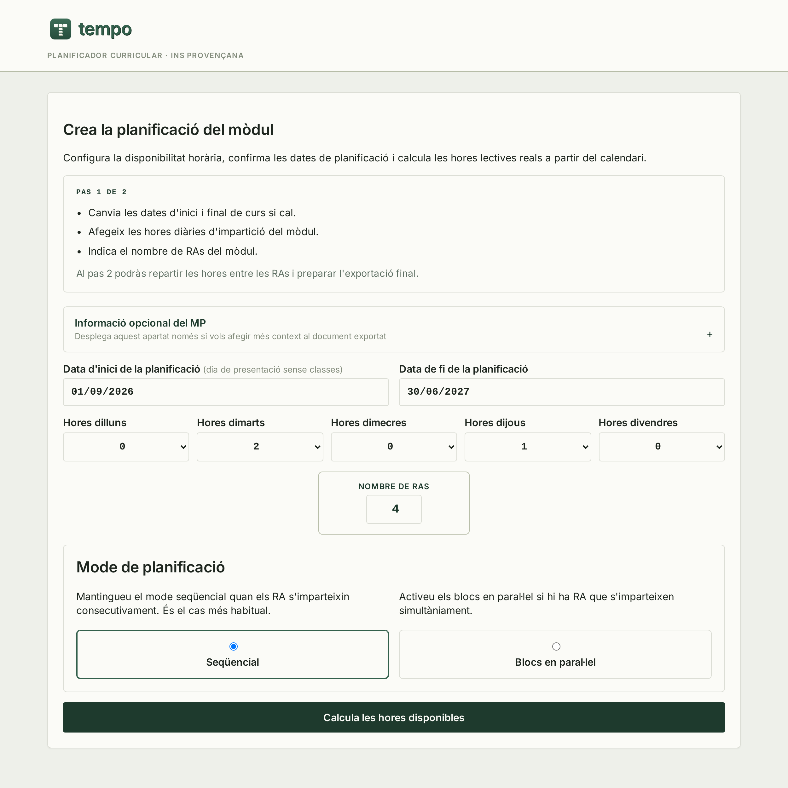
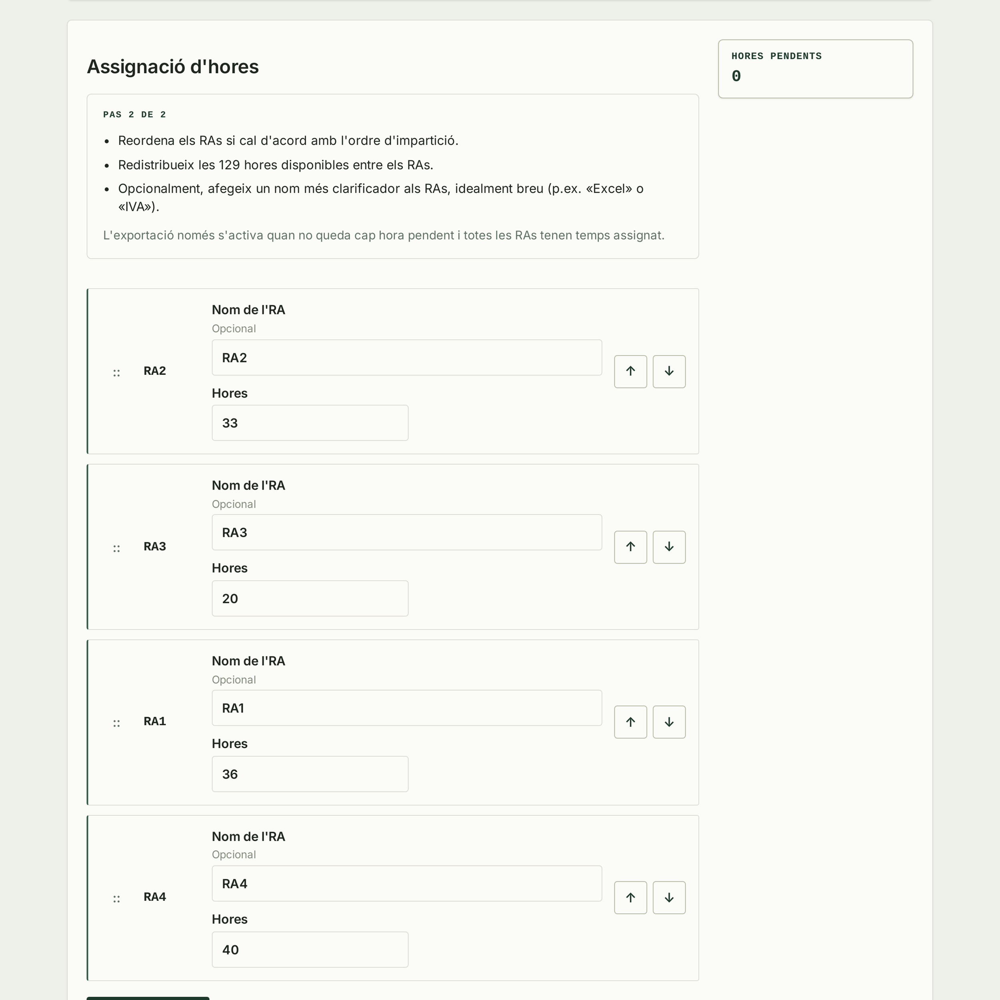
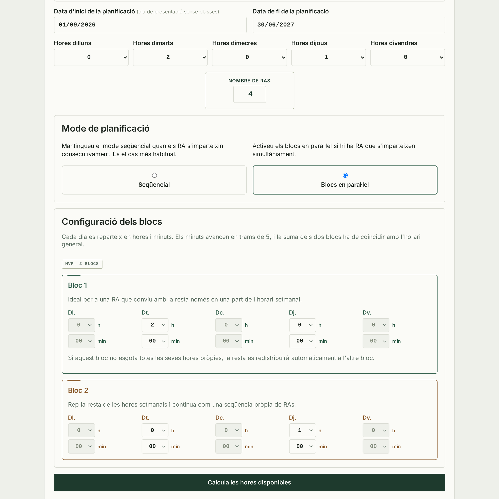
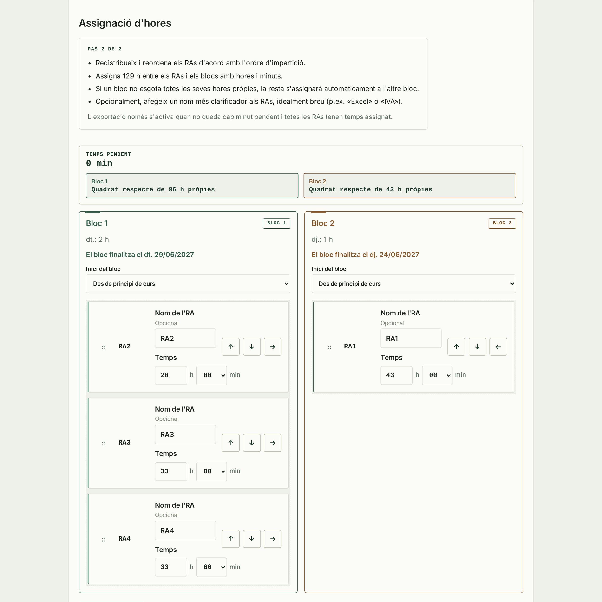
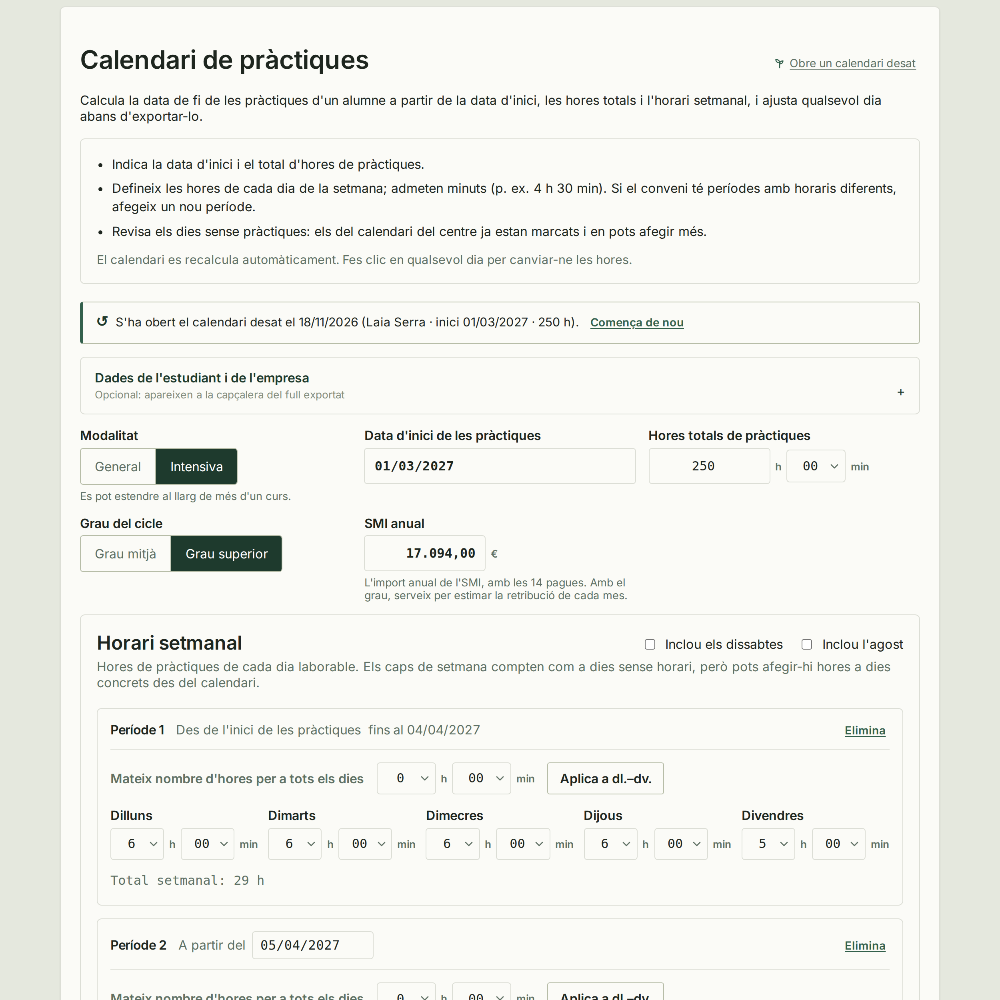
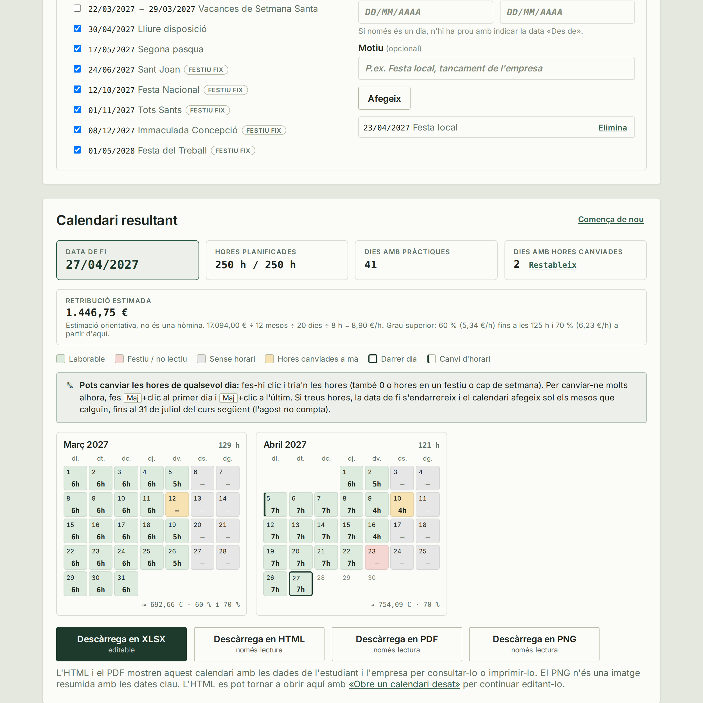
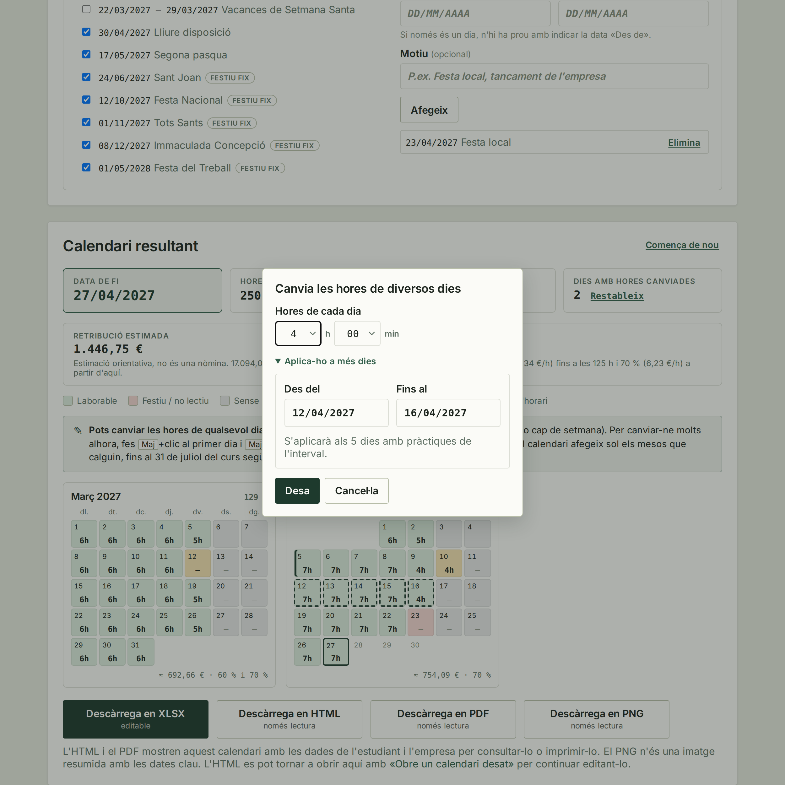

[Llegiu-lo en català](README.md)

<p align="center">
  
</p>

<p align="center">
  <strong>Compact curriculum planner for distributing teaching hours and exporting the plan as XLSX, with an internship hours planner for working out students' internship calendars.</strong>
</p>

## Contents

- [What It Does](#what-it-does)
- [Curriculum Planner](#curriculum-planner): distribute a module's hours across its learning outcomes
- [Internship Hours Planner](#internship-hours-planner): work out when a student's internship ends
- [Visual Assets](#visual-assets)
- [Stack](#stack)
- [Local Development](#local-development)
- [Production-Style Deployment](#production-style-deployment)
- [Application Flow](#application-flow)
- [Main Environment Variables](#main-environment-variables)
- [Tests](#tests)
- [Project Structure](#project-structure)
- [Brand And Design Resources](#brand-and-design-resources)
- [License](#license)

## Tempo

Tempo is a small FastAPI application built to help schools and teachers plan a module across an academic year with clarity and very little operational noise. The project stays intentionally compact: most business rules live in `app/services/`, HTTP routes in `app/routes/`, and the interface in `app/templates/`.

## Development Note

This project was developed with human direction and review, with AI assistance used for parts of the implementation, refactoring, and deployment-flow documentation. Final product decisions and responsibility for the deployed result remain with the project owner.

## What It Does

Tempo has two tools, both reachable from the app header.

**[Curriculum Planner](#curriculum-planner)** (`/`)

- defines a teaching calendar from real class days
- excludes no-class periods and blocked dates from the admin area, with fixed holidays that repeat every year
- distributes learning outcomes sequentially or in parallel blocks
- lets teachers review the distribution before export
- exports the final planning workbook as XLSX for manual review

**[Internship Hours Planner](#internship-hours-planner)** (`/practiques`)

- works out a student's internship end date from a start date, total hours and a weekly schedule, which can change between the agreement's periods
- skips the school calendar's days without internship and lets users add others
- lets users adjust any day's hours directly on the calendar
- offers two agreement modalities: general, within the school year, or intensive, which can continue into the next school year and estimates the monthly pay from the minimum wage (SMI)
- exports it as an editable XLSX that recalculates itself, or as a read-only HTML or PDF copy that looks like the web version, or as a PNG image of the calendar

## Curriculum Planner

Tempo keeps the usual journey to two decisions and one exportable result. The screenshots below follow the sequential mode, which is the most common path.

### 1. Configure The Module

Set the dates, weekly teaching hours, and number of learning outcomes. This is also where the planning mode is selected.



### 2. Allocate The Available Hours

Tempo calculates the real teaching hours after removing no-class periods, so teachers can order the learning outcomes, allocate their time, and confirm that nothing remains before export.



### 3. Review The Exported Workbook

Once the distribution is complete, the application generates an XLSX workbook ready for review and manual adjustment.


### Parallel Blocks Mode

When learning outcomes are taught at the same time, weekly hours can be split into two independent blocks and distributed with minute-level control.



In the second step, learning outcomes can be assigned, reordered, and validated within each block before the XLSX workbook is generated.



The entry screen is also available at [docs/screenshots/tempo-step-1-landing_page.png](docs/screenshots/tempo-step-1-landing_page.png). The remaining screenshots, including a second view of the exported workbook, live in [docs/screenshots/](docs/screenshots/) for more detailed documentation.

## Internship Hours Planner

The `/practiques` section is independent from module planning and works out when a student's internship ends.

### 1. Set Up The Internship

Choose the agreement's modality and enter the start date, total hours (minutes supported) and the hours for each weekday. If the agreement has periods with different schedules (e.g. shorter summer hours), add a new period and set the date it applies from. Optionally, add the student and company details shown in the header of the exported files (XLSX, HTML and PDF). The form is kept in the browser between visits.

- **General:** the internship ends within the school year it starts in. If any day has more than 4 h, a notice reminds that an intensive-type agreement is needed, and if the total goes over 400 h, another reminds that in first year the general modality allows no more (it does not appear when the "Grup" field contains a "2", for second year). Neither notice appears in the exports.
- **Intensiva:** the internship can continue into the next school year, up to 31 July. It asks for the training cycle's grade and the SMI to estimate each month's [pay](#estimated-pay-intensive-modality).
- **"Inclou els dissabtes"**, in the weekly schedule and off by default, adds Saturday to every period's schedule, in both modalities.



### 2. Review Days Without Internship And The Calendar

The school calendar's periods are pre-selected and can be unticked when they do not affect the company (e.g. an internship that runs through school holidays). Fixed holidays (those the admin marks as repeating every year, e.g. 1 May) are listed once for each year the internship spans, including academic years not configured yet, and can also be unticked one by one. They are only listed when they fall on a working day and are not inside another selected or added period: one on a weekend or inside the Christmas break does not need its own entry. Other days can be added too, such as the company's local holidays or holidays after classes end. If the internship runs past the non-teaching days configured in the school calendar, a warning in this same section reminds users to add the later holidays whose date changes every year (fixed ones are already included). The calendar recalculates live and shows the end date, planned hours and internship days; the last day only receives the hours still needed. When there are several periods, the first day of each one is marked on the calendar.



### 3. Adjust The Hours Of One Or Several Days

Clicking any day changes its hours, including setting it to 0 or adding hours on a holiday or weekend. Removing hours moves the end date later, and the calendar adds the months it needs on its own. If a day with hand-changed hours later becomes a day without internship (by ticking a period or adding it under "Altres dies sense pràctiques"), it loses those hours and a note says so; they can be set again from the calendar.

To change many days at once (e.g. from 20 October to 10 November), Shift+click the first day (it is marked without opening any dialog) and Shift+click the last one, or open "Aplica-ho a més dies" in the day's dialog. This option, folded away by default, asks for a date range and the weekdays it applies to (by default, those with hours in the schedule), shows how many days will change and highlights them on the calendar. With Shift+click the weekdays are not shown: the change applies to the days in the range that have hours in the schedule. Days without internship inside the range (holidays and non-teaching periods) are left alone unless "Inclou també els dies sense pràctiques" is ticked; that option appears when the range contains such days (e.g. to schedule hours during a break the company doesn't take). Each day is stored as an individual change, so it can be adjusted or reset like any other.

By default internships cannot run in August, so the calendar never goes past 31 July of the school year it starts in (in the intensive modality, of the next school year, with the August in between closed). If the hours do not fit, the app warns and shows the hours still pending, which need a new agreement next school year. The "Inclou l'agost" option, in the weekly schedule, allows hours in August and moves the limit to 31 August.



### Estimated Pay (Intensive Modality)

In the intensive modality, the planner estimates each month's pay from the training cycle's grade and the minimum wage (SMI, *salari mínim interprofessional*). It is an estimate, not a payslip, and it is shown in the calendar summary, next to each month, and in the XLSX (with formulas that recalculate), HTML and PDF exports.

- **Monthly or annual SMI:** the admin chooses at `/admin` whether the SMI is given as a monthly or an annual amount, and that choice applies everywhere: the planner, the calculation note and the exports show it only in that form, without mentioning the other. The amount the admin saves is offered to every calendar, which can change it; without one, each calendar has to give its own.
- **The monthly amount is one of the 14 payments, without prorating the extra ones.** With the 2026 SMI it is 1.221,00 €, not 1.424,50 € (the amount with the two extra payments spread over 12 months), which would give an estimate 17 % higher. The annual amount is the total of the 14 payments: 17.094,00 €.
- **Hourly reference:** the annual SMI (the monthly one × 14) is spread over 12 months of 20 days of 8 h: 17.094,00 € ÷ 12 ÷ 20 ÷ 8 = 8,90 €/h. It is divided by 20 days, rather than by each month's actual working days, because that slightly favours the student.
- **Percentage by grade:** grau mitjà is paid 50 % of the hourly reference for every hour; grau superior 60 % for the first half of the agreement's total hours and 70 % for the second half. A month can hold hours at both percentages. Until a grade is chosen, it follows the training cycle (CFGM or CFGS), or grau mitjà otherwise.
- **Each month** pays the hours planned in it, hand-changed ones included, at their percentage, rounded to the cent. The total adds up the rounded months, so it matches what each month shows. For example, a 320 h grau superior agreement with 160 h in September and 160 h in October gives 160 × 8,90 € × 60 % ≈ 854,70 € in September and 160 × 8,90 € × 70 % ≈ 997,15 € in October (the calculation uses the unrounded hourly reference, 8,903125 €).
- **New year:** if the hours reach a later calendar year, the estimate applies the same SMI to every month and a notice says to check it once the new amount is published.
- **Limits:** the monthly SMI can be at most 10.000,00 € and the annual one 140.000,00 €, so the annual amount typed as the monthly one is refused with a hint.
- **Calendars made in the other form:** if a draft or a saved HTML was made with a monthly SMI and it is now annual (or the other way round), it opens with the admin's amount, as does a draft whose amount is no longer valid. Only when the admin has not set one is the amount converted (× 14 or ÷ 14, rounded to the cent). Calendars saved before the choice existed count as monthly.

### Exported XLSX

- **Calendar:** one grid per month, from the start month to the month after the end date, so hours can be added past the planned end. It never goes past the agreement's limit: 31 July (in the intensive modality, of the next school year), or 31 August with "Inclou l'agost". The days of a closed August take no hours, and when August comes right after the end date, the extra month is September. If hours are still missing at the limit, the sheet says so.
- **Hours as `h:mm`:** each day is typed as `4:30`; cells only accept values between `0:00` and `12:00`, so `4` or `4,5` are rejected with a message.
- **Totals as `4h30`:** weekly, monthly, planned and remaining hours recalculate when any day is edited, as does the end date.
- **Automatic colours:** days with hours are green and days without internship (`0`, shown as `-`) are red. "Hores planificades" and "Hores restants" turn red until the target is met.
- **Instructions** in the top right corner and **sheet protection** without a password: only real days' hours and the header details can be edited.
- The **Detall** sheet (one day per row with running and remaining totals) and the **Configuració** sheet (each period's schedule with its dates, and the applied days without internship) complete the workbook.

### Read-Only HTML Copy

The "Descàrrega en HTML" (read-only) button produces a single `.html` file that looks like the web calendar: the summary, the legend, the month grids (with each day's details on hover), the weekly schedule and the applied days without internship. The header groups the details in columns: the student (name, training cycle and group), the company (name, tutor and tutor's email) and the dates (start date and total hours); empty fields and columns with no details are left out. The stylesheet, font and logo are embedded, so it opens offline in any browser and prints or saves to PDF directly.

The file cannot be edited and runs no scripts. Before downloading it, a dialog asks users to check the calendar is correct. The form's data stays in the browser, so fixing it only takes going back to `/practiques` in the same browser and downloading it again.

The file also carries the calculation's data in an inert JSON block (`#tempo-internship-plan`): the form's inputs (including the student and company details), the date it was saved and the result it gave. That is why it can be opened again from any browser with the "Obre un calendari desat" link at the top of `/practiques`, or by dropping it on the page. The file is read in the browser, replaces the current data (after asking for confirmation) and from then on the calendar works like any other: it can be edited and downloaded again in every format, including a new HTML file with the changes. If recalculating it gives a different end date or planned hours than the saved ones (because the school calendar has changed), a notice says so. The block carries a format number (`version`) so future versions of Tempo can keep reading older files.

### Read-Only PDF

The "Descàrrega en PDF" (read-only) button produces an A4 portrait PDF from the same template as the HTML copy: a header with the same detail columns, the summary, the legend, three months per row, the weekly schedule and the days without internship, with the student's name and the page number in the footer. The server renders it with [WeasyPrint](https://weasyprint.org/), which needs the Pango and HarfBuzz system libraries (the `Dockerfile` already installs them). The page layout lives in `app/static/css/internship-pdf.css`. Like the HTML copy, it asks for a review before downloading; while it is generated, a dialog shows a progress bar (estimated from the number of months) and lets users cancel.

### Read-Only PNG Image

The "Descàrrega en PNG" (read-only) button saves an image of the calendar as it looks on the page: the summary with the end date, the legend and the month grids, without the editing hint or the buttons, and without the student and company details. The browser draws it from a fixed-width copy of the calendar (three months per row, at double resolution) using the [html-to-image](https://github.com/bubkoo/html-to-image) library (MIT), vendored in `app/static/js/vendor/`. The server only counts the download (`/practiques/export-png`). Like the HTML and PDF copies, it asks for a review before downloading.

> **Maintenance note:** the month grid is drawn in two places: in the browser with JavaScript (`renderResult` in `app/templates/internship/index.html`), and on the server for the HTML and PDF copies (`build_month_views` in `app/services/internship_html.py` and `app/templates/internship/export.html`; the PDF places the same day cells, through the `day_cell` macro, in tables instead of a CSS grid, because WeasyPrint lays tables out much faster). Dates and hours always come from the same calculation and cannot diverge, but the presentation can. Day-type names, the legend (`internship/_legend.html`) and the CSS classes are shared; any other change to the grid (a marker, a class or a detail in a day's tooltip) has to be made in both places. Tests in `tests/test_internship.py` check that both share labels and legend.

## Visual Assets

- `design/brand/` holds the master brand and logo assets
- `docs/screenshots/` holds documentation-ready screenshots
- [docs/screenshots/README.md](docs/screenshots/README.md) explains the purpose and maintenance of each screenshot

## Stack

- FastAPI
- Jinja templates and lightweight JavaScript
- SQLite
- SQLAlchemy
- openpyxl
- WeasyPrint (PDF export)
- html-to-image (PNG export, in the browser)
- Docker Compose

## Local Development

`docker-compose.yml` is set up for local development:

- `./app` and `./tests` are bind-mounted into the container
- Uvicorn runs with `--reload`
- the SQLite database is stored in `./data/app.db`

Steps:

1. Copy `.env.example` to your own `.env` file if you want custom values.
2. Start the app:

```bash
docker compose up --build
```

3. Open `http://localhost:8000`
4. The teacher flow is available at `/`
5. The admin area is available at `/admin`

If port `8000` is already busy:

```bash
HOST_PORT=10080 docker compose up --build
```

## Production-Style Deployment

Use `docker-compose.production.yml` when you want a reproducible container run without bind mounts or `--reload`.

```bash
ENV_FILE=/absolute/path/to/.env.prod DATA_DIR=/absolute/path/to/data HOST_PORT=8091 docker compose -f docker-compose.production.yml up -d --build
```

You can also use the repository helper script:

```bash
ENV_FILE=/absolute/path/to/.env.prod DATA_DIR=/absolute/path/to/data HOST_PORT=8091 bash scripts/deploy_production.sh
```

For branch preview deployments:

```bash
bash scripts/deploy_preview.sh
```

The production and preview containers run as an unprivileged user (`10001:10001`), limited to 1 GB of memory and 256 processes. The data directory (`DATA_DIR`) must be writable by that user, or the app cannot write its database:

```bash
sudo chown -R 10001:10001 /absolute/path/to/data
```

The `preview` branch is permanent: it is the branch used for preview deployments and must not be deleted, even once it is fully merged into `main`.

### Build Identification

Deployments that set `APP_ENV` show the deployed build in a small footer and expose it at `/build-info.json` (`Cache-Control: no-cache`):

- `scripts/build-env.sh` reads the commit SHA on the host and refuses uncommitted tracked changes (`ALLOW_DIRTY=1` overrides it). The SHA and build time are baked into the image as `GIT_COMMIT` and `BUILD_TIME`, and also as the `org.opencontainers.image.revision` label.
- `scripts/update-release-info.sh` writes `build-meta/release-info.json` from the latest published GitHub release (it needs an authenticated `gh` on the host), or `null` when it cannot be verified. The app re-reads the file on every request, so publishing a release only requires running the script again, not rebuilding.
- `APP_ENV` (`preview` or `production`) and `REPO_URL` are runtime settings. The footer shows `Preview · <sha>` in preview, `<release> · <sha>` in production (`Build · <sha>` without a release), and `Build unknown` when the SHA is missing. Without `APP_ENV` there is no footer.

`scripts/deploy_preview.sh` and `scripts/deploy_production.sh` already do all of this. To publish a release without redeploying, run `scripts/update-release-info.sh build-meta/release-info.json <deployed sha>` in the deployed checkout.

## Application Flow

### Teacher Flow

- `/` shows the initial module configuration form
- `/plan` lets users sort, distribute, and validate learning outcomes before export
- the final export is generated as an XLSX workbook
- `/practiques` computes an internship calendar, in the general or the intensive modality, from a start date, total hours and a weekly schedule (minutes supported, with optional periods that each have their own schedule), reuses the configured non-teaching periods, lets users adjust any day's hours and exports an editable XLSX or a read-only HTML, PDF or PNG copy; in the intensive modality, it also estimates the pay (see [Internship Hours Planner](#internship-hours-planner))

### Admin Flow

- `/admin` is authentication-protected; after 10 failed login attempts within 15 minutes from the same address, it refuses new ones for the rest of that window ("Massa intents", HTTP 429). Attempts are counted in each server process's memory and reset when the app restarts
- the automatic API docs (`/docs`, `/redoc`, `/openapi.json`) are switched off
- it manages academic years and excluded dates, plus fixed holidays (day and month) that apply to every academic year, including those not configured yet
- it sets the SMI for the intensive modality's [estimated pay](#estimated-pay-intensive-modality) and whether it is given as a monthly or an annual amount; switching converts the amount, and switching back restores exactly the last amount saved in that form
- `/admin/usage` shows how often each tool was opened and how many plans and exports were completed (for internships, split between XLSX, HTML, PDF and PNG), for the last 7 and 30 days, all time, and the last 12 weeks. Counting is anonymous: only one number per day and action is stored, with no IP addresses, cookies, or browser data, and bots and monitors are skipped
- it is not linked from the public UI

## Main Environment Variables

- `APP_NAME`: main product name shown in the UI
- `SCHOOL_NAME`: optional suffix in the title and header
- `SECRET_KEY`: session signing secret
- `ADMIN_USERNAME`: admin username
- `ADMIN_PASSWORD`: admin password
- `DATABASE_URL`: SQLAlchemy connection URL
- `WEB_CONCURRENCY`: process count for the production-style server runtime
- `APP_ENV`: `preview` or `production`; enables the build footer (see [Build Identification](#build-identification))
- `REPO_URL`: optional repository URL used to link the footer to the commit and release
- `BUILD_META_DIR`: directory holding `release-info.json` (default `build-meta`)

## Tests

To run the main test suite:

```bash
docker compose run --rm web pytest
```

To run the focused service tests directly:

```bash
pytest tests/test_services.py
```

The internship planner also has browser tests in `tests/browser`, for the behaviour that lives in the page's script. They start the app with a temporary database and drive it with Chromium. Without Playwright they are skipped, as in the Docker image, so to run them use an environment of your own:

```bash
pip install -r requirements-dev.txt
python -m playwright install chromium
pytest tests/browser
```

Continuous integration (`.github/workflows/pytest.yml`) runs the main suite and the browser tests with Chromium on every push to `main` and `preview` and on every pull request.

## Project Structure

```text
app/
  routes/
  services/
  static/
  templates/
design/
  brand/
docs/
  screenshots/
scripts/
tests/
README.md
README.en.md
```

## Brand And Design Resources

- `design/tempo-design-system.md`: canonical visual-system reference
- `design/brand/README.md`: correct logo usage and variants
- `design/brand/build_svgs.py`: generates every logo SVG from the design-system values (`--check` reports drift)
- `app/static/img/`: curated subset of logo assets served by the app

## License

This project is licensed under `AGPL-3.0-only`. See [LICENSE](LICENSE).
