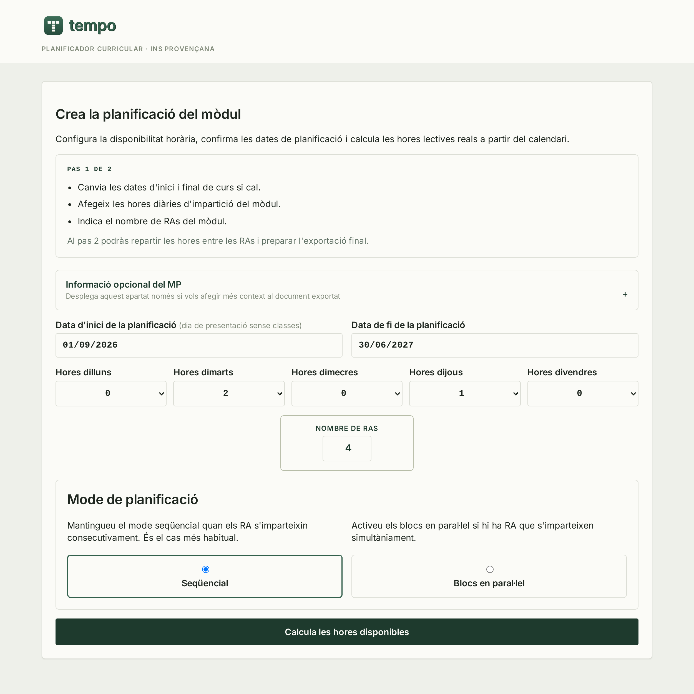
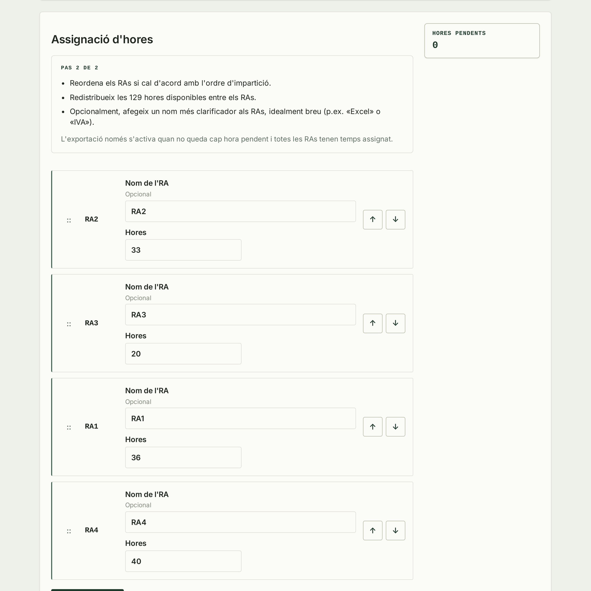
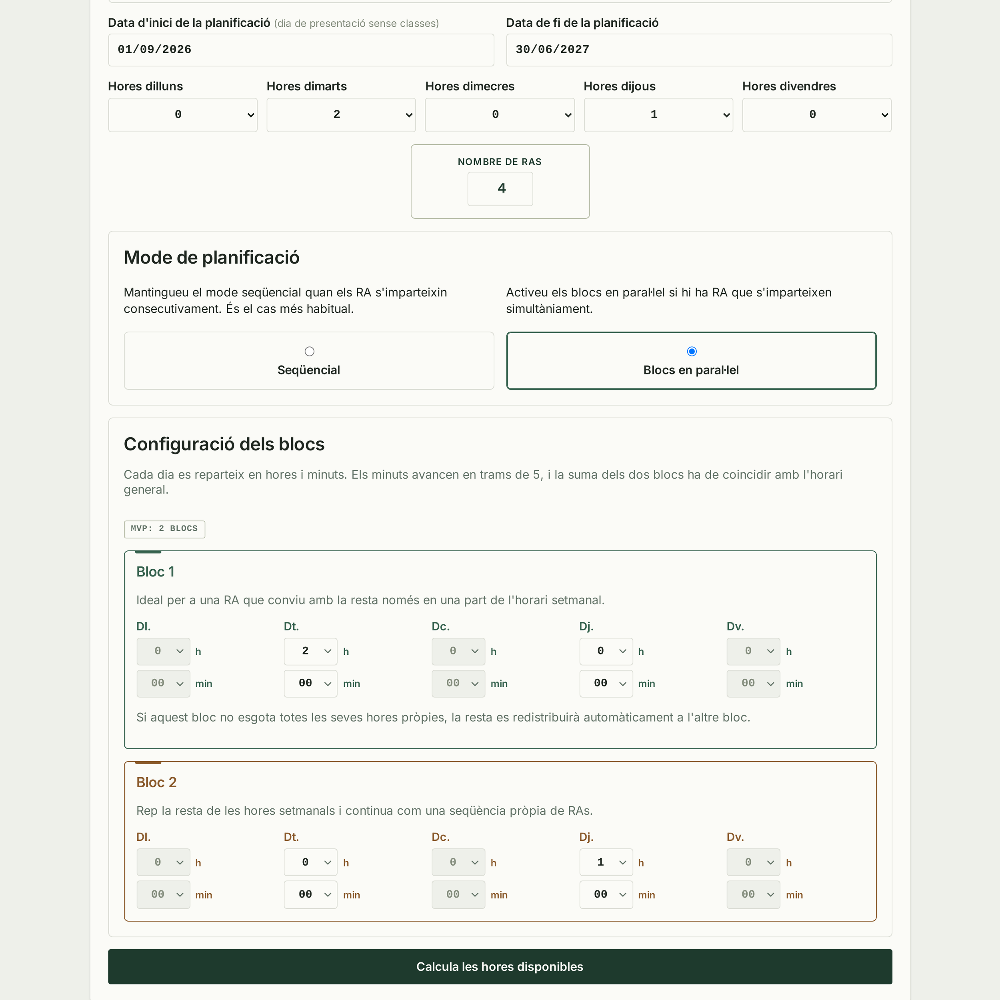
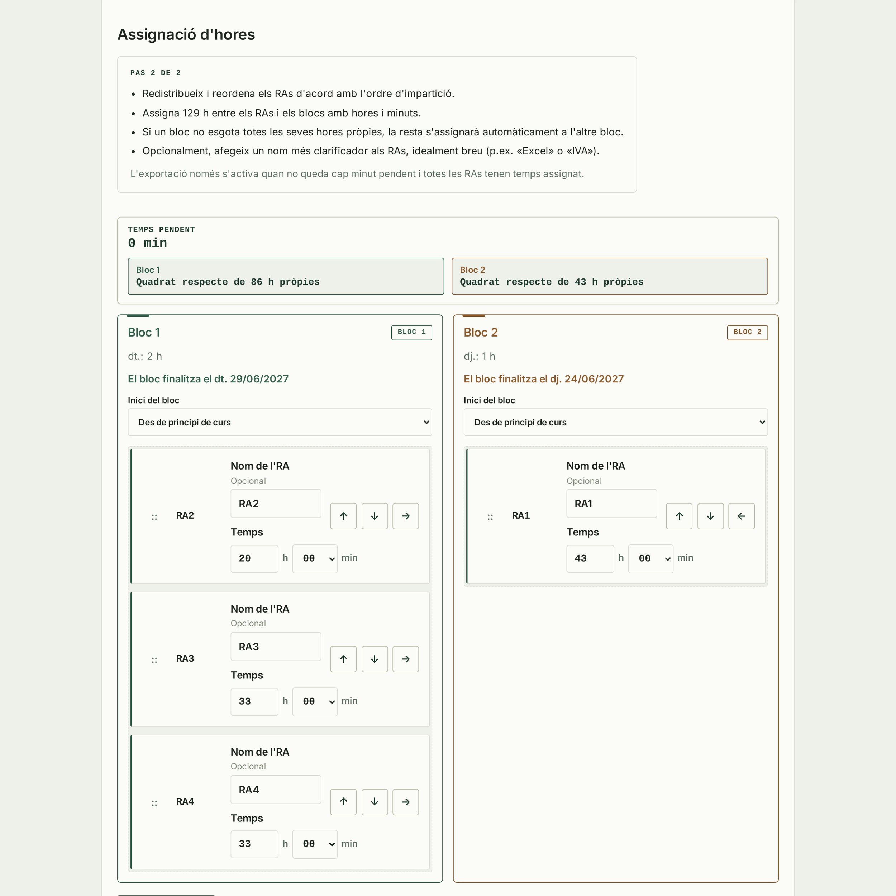
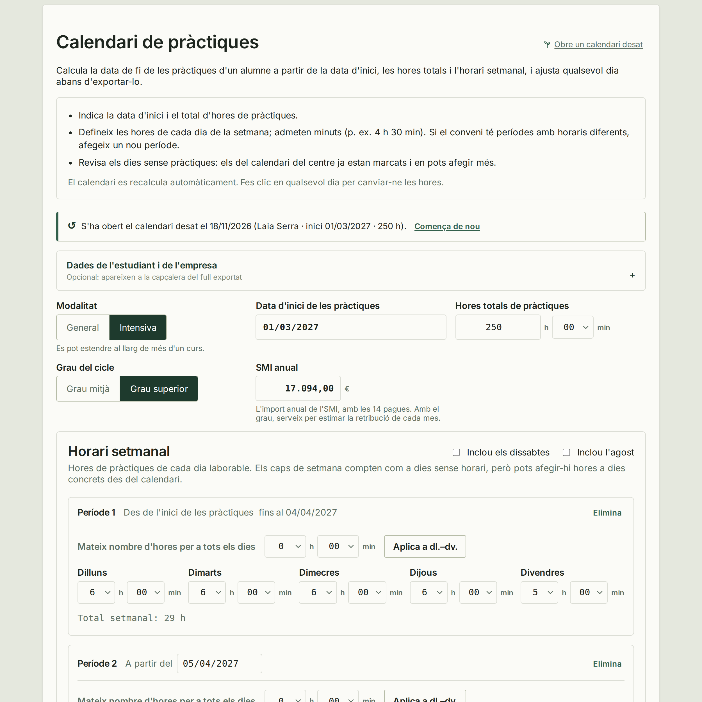
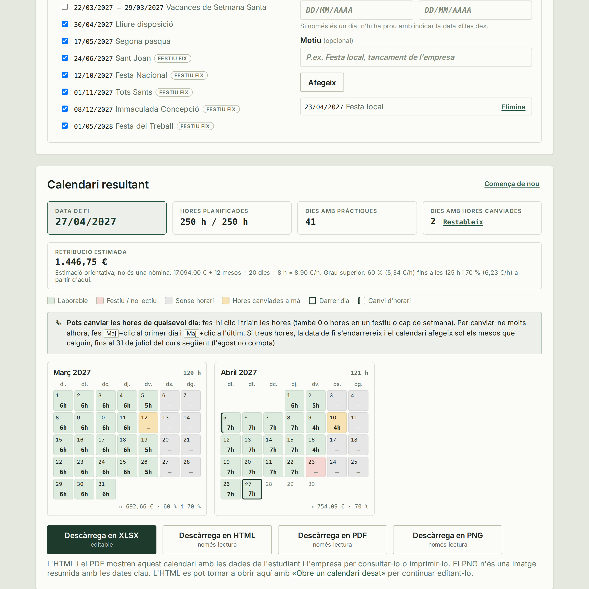
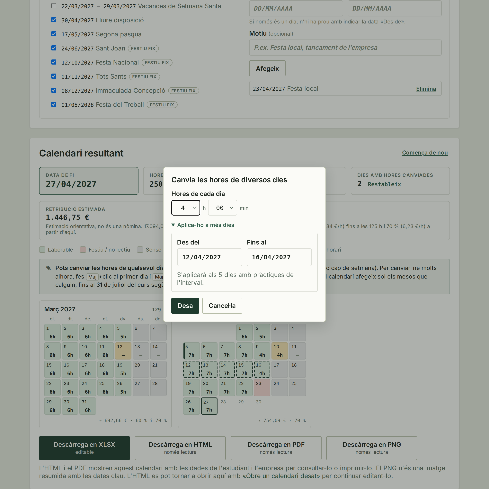

[Read this in English](README.en.md)

<p align="center">
  
</p>

<p align="center">
  <strong>Planificador curricular compacte per distribuir hores lectives i exportar la planificació en XLSX, amb un planificador d'hores de pràctiques per calcular el calendari de pràctiques dels estudiants.</strong>
</p>

## Índex

- [Què permet fer](#què-permet-fer)
- [Planificador curricular](#planificador-curricular): reparteix les hores d'un mòdul entre els seus RAs
- [Planificador d'hores de pràctiques](#planificador-dhores-de-pràctiques): calcula quan acaben les pràctiques d'un estudiant
- [Actius visuals](#actius-visuals)
- [Stack](#stack)
- [Posada en marxa local](#posada-en-marxa-local)
- [Desplegament tipus producció](#desplegament-tipus-producció)
- [Flux de l'aplicació](#flux-de-laplicació)
- [Variables d'entorn principals](#variables-dentorn-principals)
- [Proves](#proves)
- [Estructura del projecte](#estructura-del-projecte)
- [Recursos de marca i disseny](#recursos-de-marca-i-disseny)
- [Llicència](#llicència)

## Tempo

Tempo és una aplicació petita basada en FastAPI pensada per ajudar centres i professorat a planificar un mòdul al llarg del curs acadèmic amb criteri i sense soroll innecessari. El projecte manté una arquitectura compacta: les regles de negoci viuen principalment a `app/services/`, les rutes HTTP a `app/routes/` i la interfície a `app/templates/`.

## Nota de desenvolupament

Aquest projecte s'ha desenvolupat amb direcció i revisió humanes, amb suport d'eines d'IA per a parts de la implementació, refactorització i documentació del flux de desplegament. Les decisions finals de producte i la responsabilitat sobre el resultat continuen recaient en el responsable del projecte.

## Què permet fer

Tempo té dues eines, accessibles des de la capçalera de l'aplicació.

**[Planificador curricular](#planificador-curricular)** (`/`)

- definir el calendari lectiu d'un mòdul a partir de dies reals de classe
- excloure períodes no lectius i dates bloquejades des de l'àrea d'administració, amb festius fixos que es repeteixen cada any
- repartir Resultats d'Aprenentatge en seqüència o en blocs paral·lels
- revisar la distribució abans de generar el fitxer final
- exportar la planificació en un llibre XLSX preparat per a revisió manual

**[Planificador d'hores de pràctiques](#planificador-dhores-de-pràctiques)** (`/practiques`)

- calcular la data de fi de les pràctiques d'un estudiant a partir de la data d'inici, les hores totals i l'horari setmanal, que pot canviar d'un període a un altre del conveni
- descomptar els dies sense pràctiques del calendari del centre i afegir-ne d'altres
- ajustar les hores de qualsevol dia directament al calendari
- exportar-lo en un XLSX editable que es recalcula sol, o en una còpia HTML o PDF de només lectura amb el mateix aspecte que el web, o en una imatge PNG del calendari

## Planificador curricular

Tempo concentra el flux habitual en dues decisions i un resultat exportable. Les captures següents expliquen aquest recorregut amb el mode seqüencial, que és el cas més habitual.

### 1. Configura el mòdul

Defineix les dates, les hores lectives de cada dia i el nombre de RAs. Des d'aquí també es tria el mode de planificació.



### 2. Reparteix les hores disponibles

Tempo calcula les hores lectives reals, descomptant els períodes sense classe, perquè el professorat pugui ordenar els RAs, assignar-los temps i comprovar que no queda cap hora pendent abans de l'exportació.



### 3. Revisa el llibre exportat

Quan la distribució és completa, l'aplicació genera un llibre XLSX preparat per a la revisió i l'ajust manual.


### Mode per blocs en paral·lel

Quan alguns RAs s'imparteixen simultàniament, es poden dividir les hores setmanals en dos blocs independents i controlar-ne la distribució en minuts.



Al segon pas, els RAs es poden repartir, reordenar i validar dins de cada bloc abans de generar el llibre XLSX.



La pàgina d'entrada també està disponible a [docs/screenshots/tempo-step-1-landing_page.png](docs/screenshots/tempo-step-1-landing_page.png). Les captures restants, inclosa una segona vista del llibre exportat, es conserven a [docs/screenshots/](docs/screenshots/) per a documentació més detallada.

## Planificador d'hores de pràctiques

La secció `/practiques` és independent de la planificació de mòduls i calcula quan acaba el període de pràctiques d'un estudiant.

### 1. Configura les pràctiques

Tria la modalitat del conveni i indica la data d'inici, les hores totals (amb minuts) i les hores de cada dia de la setmana. Si el conveni té períodes amb horaris diferents (p. ex. jornada intensiva a l'estiu), afegeix un nou període i indica a partir de quin dia s'aplica. Opcionalment, afegeix les dades de l'estudiant i de l'empresa, que apareixen a la capçalera dels fitxers exportats (XLSX, HTML i PDF). El formulari es conserva al navegador entre visites.

- **General:** les pràctiques acaben dins del curs en què comencen. Si algun dia té més de 4 h, un avís recorda que cal un tipus d'acord intensiu, i si el total passa de 400 h, un altre recorda que a 1r curs la modalitat general no en permet més (no surt si el camp «Grup» conté un «2», de segon curs). Cap dels dos avisos surt a les exportacions.
- **Intensiva:** les pràctiques poden continuar el curs següent, fins al 31 de juliol. Demana el grau del cicle i l'SMI per estimar la [retribució](#retribució-estimada-modalitat-intensiva) de cada mes.
- **«Inclou els dissabtes»**, a l'horari setmanal i desmarcada per defecte, afegeix el dissabte a l'horari de cada període, en totes dues modalitats.



### 2. Revisa els dies sense pràctiques i el calendari

Els períodes del calendari del centre surten marcats i es poden desmarcar si no afecten l'empresa (p. ex. pràctiques durant les vacances escolars). Els festius fixos (els que l'administració marca com a repetits cada any, p. ex. l'1 de maig) hi surten un cop per cada any que abasten les pràctiques, també en cursos encara no configurats, i també es poden desmarcar un per un. Només hi surten quan cauen en un dia laborable i no queden dins d'un altre període marcat o afegit: si cauen en cap de setmana o dins de les vacances de Nadal, no cal llistar-los a part. També s'hi poden afegir altres dies, com festius locals de l'empresa o festius posteriors a les classes. Si les pràctiques van més enllà dels dies no lectius configurats al calendari del centre, un avís en aquesta mateixa secció recorda afegir-hi els festius posteriors que canvien de data cada any (els fixos ja hi són). El calendari es recalcula en directe i mostra la data de fi, les hores planificades i els dies amb pràctiques; el darrer dia només rep les hores que falten. Quan hi ha diversos períodes, el primer dia de cadascun queda marcat al calendari.



### 3. Ajusta les hores d'un dia o de diversos dies

En fer clic a qualsevol dia se'n poden canviar les hores, fins i tot posar-hi 0 o afegir-ne en un festiu o cap de setmana. Si es treuen hores, la data de fi s'endarrereix i el calendari afegeix sol els mesos necessaris. Si després un dia amb hores canviades a mà passa a ser un dia sense pràctiques (marcant un període o afegint-lo a «Altres dies sense pràctiques»), en perd les hores i un avís ho indica; es poden tornar a posar des del calendari.

Per canviar les hores de molts dies alhora (p. ex. del 20 d'octubre al 10 de novembre), es fa Maj+clic al primer dia (queda marcat sense obrir cap finestra) i Maj+clic a l'últim, o s'obre «Aplica-ho a més dies» a la finestra del dia. Aquesta opció, plegada per defecte, demana un interval de dates i els dies de la setmana afectats (de sortida, els que tenen hores a l'horari), mostra quants dies canviaran i els ressalta al calendari. Amb Maj+clic no es mostren els dies de la setmana: el canvi s'aplica als dies de l'interval que tenen hores a l'horari. Els dies sense pràctiques de l'interval (festius i períodes no lectius) no es toquen, tret que es marqui «Inclou també els dies sense pràctiques», que apareix quan l'interval en conté (p. ex. per posar hores durant unes vacances que l'empresa no fa). Cada dia queda desat com un canvi individual, així que es pot retocar o restablir com qualsevol altre.

Per defecte, a l'agost no es poden fer pràctiques, així que el calendari no passa mai del 31 de juliol del curs en què comencen (en la modalitat intensiva, del curs següent, i l'agost entremig queda tancat). Si les hores no hi caben, l'aplicació avisa i mostra les hores que falten, que s'hauran de fer amb un nou conveni el curs vinent. L'opció «Inclou l'agost», a l'horari setmanal, hi permet hores i porta el límit fins al 31 d'agost.



### Retribució estimada (modalitat intensiva)

En la modalitat intensiva, el planificador estima la retribució de cada mes a partir del grau del cicle i del salari mínim interprofessional (SMI). És una estimació orientativa, no una nòmina, i es mostra al resum del calendari, al costat de cada mes, i a les exportacions XLSX (amb fórmules que es recalculen), HTML i PDF.

- **SMI mensual o anual:** l'administració tria a `/admin` si l'SMI s'indica com a import mensual o anual, i la tria s'aplica a tot arreu: el planificador, la nota del càlcul i les exportacions el mostren només d'aquesta manera, sense esmentar l'altra. L'import que hi desa l'administració es proposa a cada calendari, que el pot canviar; si no n'hi ha cap, cal indicar-lo a cada calendari.
- **L'import mensual és una de les 14 pagues, sense prorratejar les extres.** Amb l'SMI de 2026 és 1.221,00 €, no 1.424,50 € (l'import amb les dues pagues extraordinàries repartides en 12 mesos), que donaria una estimació un 17 % més alta. L'import anual és el total de les 14 pagues: 17.094,00 €.
- **Preu de referència per hora:** l'SMI anual (el mensual × 14) es reparteix en 12 mesos de 20 dies de 8 h: 17.094,00 € ÷ 12 ÷ 20 ÷ 8 = 8,90 €/h. Es divideix per 20 dies, i no pels dies laborables reals de cada mes, perquè afavoreix lleugerament l'estudiant.
- **Percentatge segons el grau:** en grau mitjà, el 50 % del preu per hora per a totes les hores; en grau superior, el 60 % per a la primera meitat de les hores totals del conveni i el 70 % per a la segona. Un mes pot tenir hores als dos percentatges. Si no es tria el grau, se segueix el cicle formatiu (CFGM o CFGS) o, si no, el grau mitjà.
- **Cada mes** cobra les hores planificades en aquell mes, incloses les canviades a mà, al seu percentatge, i s'arrodoneix al cèntim. El total és la suma dels mesos arrodonits, de manera que coincideix amb el que es mostra a cadascun. Per exemple, un conveni de 320 h en grau superior amb 160 h al setembre i 160 h a l'octubre dona 160 × 8,90 € × 60 % ≈ 854,70 € al setembre i 160 × 8,90 € × 70 % ≈ 997,15 € a l'octubre (el càlcul fa servir el preu per hora sense arrodonir, 8,903125 €).
- **Canvi d'any:** si les hores arriben a un any natural posterior, l'estimació aplica el mateix SMI a tots els mesos i un avís recorda revisar-lo quan es publiqui el nou import.
- **Límits:** l'SMI mensual pot ser com a màxim de 10.000,00 € i l'anual de 140.000,00 €, de manera que l'import anual escrit com a mensual es rebutja amb un avís.
- **Calendaris fets amb l'altra forma:** si un esborrany o un HTML desat es va fer amb l'SMI mensual i ara és anual (o al revés), en obrir-lo agafa l'import de l'administració, igual que un esborrany amb un import que ja no és vàlid. Només si l'administració no n'ha indicat cap, l'import es converteix (× 14 o ÷ 14, arrodonit al cèntim). Els calendaris desats abans que es pogués triar es consideren mensuals.

### Full XLSX exportat

- **Calendari:** una graella per mes, des del mes d'inici fins al mes posterior a la data de fi (com a màxim fins al 31 de juliol), perquè es puguin afegir hores més enllà de la data prevista. Si al juliol encara falten hores, el full ho indica.
- **Hores en format `h:mm`:** cada dia s'escriu com `4:30`; les caselles només accepten valors entre `0:00` i `12:00`, de manera que `4` o `4,5` es rebutgen amb un avís.
- **Totals en format `4h30`:** setmanes, mesos, hores planificades i hores restants es recalculen en editar qualsevol dia, igual que la data de fi.
- **Colors automàtics:** els dies amb hores es mostren en verd i els dies sense pràctiques (`0`, que es mostra com `-`) en vermell. «Hores planificades» i «Hores restants» es marquen en vermell mentre no s'arriba a l'objectiu.
- **Instruccions** a la cantonada superior dreta i **protecció del full** sense contrasenya: només es poden editar les hores dels dies reals i les dades de la capçalera.
- Els fulls **Detall** (un dia per fila amb acumulat i hores restants) i **Configuració** (l'horari de cada període amb les seves dates i els dies sense pràctiques aplicats) completen el llibre.

### Còpia HTML de només lectura

El botó «Descàrrega en HTML» (només lectura) genera un únic fitxer `.html` amb el mateix aspecte que el calendari del web: el resum, la llegenda, les graelles mensuals (amb el detall de cada dia en passar-hi el ratolí), l'horari setmanal i els dies sense pràctiques aplicats. La capçalera agrupa les dades en columnes: l'estudiant (nom, cicle formatiu i grup), l'empresa (nom, tutor/a i correu del tutor/a) i les dates (data d'inici i hores totals); les dades buides i les columnes sense cap dada no es mostren. El full d'estils, la tipografia i el logotip van incrustats, de manera que s'obre sense connexió, en qualsevol navegador, i s'imprimeix o es desa en PDF directament.

El fitxer no admet canvis i no executa cap script. Abans de descarregar-lo, una finestra demana revisar que el calendari sigui correcte. Les dades del formulari es conserven al navegador, de manera que per corregir-lo n'hi ha prou amb tornar a `/practiques` des del mateix navegador i descarregar-lo de nou.

El fitxer també inclou les dades del càlcul en un bloc JSON inert (`#tempo-internship-plan`): les dades del formulari (incloses les de l'estudiant i l'empresa), la data en què es va desar i el resultat obtingut. Per això es pot tornar a obrir des de qualsevol navegador amb l'enllaç «Obre un calendari desat» de la part superior de `/practiques`, o deixant-lo anar damunt de la pàgina. El fitxer es llegeix al navegador, substitueix les dades actuals (després de demanar confirmació) i a partir d'aquí el calendari funciona com qualsevol altre: es pot editar i tornar a descarregar en tots els formats, també en un HTML nou amb els canvis. Si en recalcular-lo la data de fi o les hores planificades no coincideixen amb les desades (perquè ha canviat el calendari del centre), un avís ho indica. El bloc porta un número de format (`version`) perquè les versions futures de Tempo puguin continuar llegint els fitxers antics.

### PDF de només lectura

El botó «Descàrrega en PDF» (només lectura) genera un PDF en A4 vertical a partir de la mateixa plantilla que la còpia HTML: capçalera amb les mateixes columnes de dades, el resum, la llegenda, tres mesos per fila, l'horari setmanal i els dies sense pràctiques, amb el nom de l'estudiant i el número de pàgina al peu. El genera el servidor amb [WeasyPrint](https://weasyprint.org/), que necessita les biblioteques de sistema Pango i HarfBuzz (el `Dockerfile` ja les instal·la). El format de pàgina és a `app/static/css/internship-pdf.css`. Igual que l'HTML, demana una revisió abans de descarregar-lo; mentre es genera, una finestra mostra una barra de progrés (estimada segons el nombre de mesos) i permet cancel·lar-lo.

### Imatge PNG de només lectura

El botó «Descàrrega en PNG» (només lectura) desa una imatge del calendari tal com es veu a la pàgina: el resum amb la data de fi, la llegenda i les graelles mensuals, sense l'ajuda per editar ni els botons, i sense les dades de l'estudiant i l'empresa. La genera el navegador a partir d'una còpia del calendari amb amplada fixa (tres mesos per fila, a doble resolució) amb la biblioteca [html-to-image](https://github.com/bubkoo/html-to-image) (MIT), inclosa a `app/static/js/vendor/`. El servidor només en compta la descàrrega (`/practiques/export-png`). Com l'HTML i el PDF, demana una revisió abans de descarregar-la.

> **Nota de manteniment:** la graella mensual es dibuixa en dos llocs: al navegador, amb JavaScript (`renderResult` a `app/templates/internship/index.html`), i al servidor per a les còpies HTML i PDF (`build_month_views` a `app/services/internship_html.py` i `app/templates/internship/export.html`; el PDF col·loca els mateixos dies, amb la macro `day_cell`, en taules en lloc d'una graella CSS, perquè WeasyPrint les compon molt més de pressa). Les dates i les hores surten sempre del mateix càlcul i no poden divergir, però la presentació sí. Els noms dels tipus de dia, la llegenda (`internship/_legend.html`) i les classes CSS són compartits; qualsevol altre canvi a la graella (un marcador, una classe o un detall del text d'ajuda d'un dia) s'ha de fer en tots dos llocs. Les proves de `tests/test_internship.py` comproven que els dos comparteixen etiquetes i llegenda.

## Actius visuals

- `design/brand/` conté els actius mestres de marca i logotip
- `docs/screenshots/` conté les captures optimitzades per a documentació
- [docs/screenshots/README.md](docs/screenshots/README.md) explica el propòsit i manteniment de cada captura

## Stack

- FastAPI
- Jinja templates i JavaScript lleuger
- SQLite
- SQLAlchemy
- openpyxl
- WeasyPrint (exportació en PDF)
- html-to-image (exportació en PNG, al navegador)
- Docker Compose

## Posada en marxa local

El fitxer `docker-compose.yml` està pensat per a desenvolupament local:

- `./app` i `./tests` es munten dins del contenidor
- Uvicorn s'executa amb `--reload`
- la base de dades SQLite es conserva a `./data/app.db`

Passos:

1. Copia `.env.example` a un `.env` propi si vols personalitzar valors.
2. Inicia l'aplicació:

```bash
docker compose up --build
```

3. Obre `http://localhost:8000`
4. El flux de professorat és a `/`
5. L'àrea d'administració és a `/admin`

Si el port `8000` està ocupat:

```bash
HOST_PORT=10080 docker compose up --build
```

## Desplegament tipus producció

Per a una execució sense bind mounts ni `--reload`, fes servir `docker-compose.production.yml`.

```bash
ENV_FILE=/absolute/path/to/.env.prod DATA_DIR=/absolute/path/to/data HOST_PORT=8091 docker compose -f docker-compose.production.yml up -d --build
```

També hi ha l'script del repositori:

```bash
ENV_FILE=/absolute/path/to/.env.prod DATA_DIR=/absolute/path/to/data HOST_PORT=8091 bash scripts/deploy_production.sh
```

Per a una previsualització de branca:

```bash
bash scripts/deploy_preview.sh
```

La branca `preview` és permanent: és la que s'utilitza per a les previsualitzacions i no s'ha d'esborrar, encara que ja estigui fusionada a `main`.

### Identificació de la compilació

Els desplegaments que defineixen `APP_ENV` mostren la compilació desplegada en un petit peu de pàgina i l'exposen a `/build-info.json` (`Cache-Control: no-cache`):

- `scripts/build-env.sh` llegeix el SHA del commit a l'amfitrió i refusa canvis seguits sense confirmar (`ALLOW_DIRTY=1` ho permet). El SHA i l'hora de compilació queden incrustats a la imatge com a `GIT_COMMIT` i `BUILD_TIME`, i també com a etiqueta `org.opencontainers.image.revision`.
- `scripts/update-release-info.sh` escriu `build-meta/release-info.json` a partir de l'última versió publicada a GitHub (cal un `gh` autenticat a l'amfitrió), o `null` si no es pot verificar. L'aplicació torna a llegir el fitxer a cada petició, de manera que publicar una versió només requereix tornar a executar l'script, sense recompilar.
- `APP_ENV` (`preview` o `production`) i `REPO_URL` són paràmetres d'execució. El peu mostra `Preview · <sha>` a la previsualització, `<versió> · <sha>` a producció (`Build · <sha>` si no hi ha cap versió publicada) i `Build unknown` si falta el SHA. Sense `APP_ENV` no hi ha peu.

`scripts/deploy_preview.sh` i `scripts/deploy_production.sh` ja ho fan tot. Per mostrar una versió acabada de publicar sense tornar a desplegar, executa `scripts/update-release-info.sh build-meta/release-info.json <sha desplegat>` a la còpia desplegada.

## Flux de l'aplicació

### Professorat

- `/` mostra el formulari inicial de configuració del mòdul
- `/plan` permet ordenar, repartir i validar els RAs abans d'exportar
- l'exportació final es fa cap a un llibre XLSX
- `/practiques` calcula el calendari de pràctiques a partir de la data d'inici, les hores totals i l'horari setmanal (amb minuts i, si cal, diversos períodes amb horari propi), reutilitza els períodes no lectius configurats, permet ajustar les hores de qualsevol dia i exporta un XLSX editable o una còpia HTML, PDF o PNG de només lectura (vegeu [Planificador d'hores de pràctiques](#planificador-dhores-de-pràctiques))

### Administració

- `/admin` està protegit per autenticació
- permet gestionar anys acadèmics i dates excloses, i també festius fixos (dia i mes) que s'apliquen a tots els cursos, fins i tot als que encara no s'han configurat
- hi fixa l'SMI de la [retribució estimada](#retribució-estimada-modalitat-intensiva) de la modalitat intensiva i tria si s'indica com a import mensual o anual; en canviar de forma, l'import es converteix sol i, si torna a la forma anterior, recupera exactament l'últim import desat en aquella forma
- `/admin/usage` mostra quantes vegades s'ha obert cada eina i quantes planificacions i exportacions (en el cas de les pràctiques, separades entre XLSX, HTML, PDF i PNG) s'han completat, per als últims 7 i 30 dies, el total i les últimes 12 setmanes. El recompte és anònim: només es desa un número per dia i acció, sense adreces IP, galetes ni dades del navegador, i no inclou robots ni monitors
- no apareix enllaçat des de la interfície pública

## Variables d'entorn principals

- `APP_NAME`: nom principal visible a la interfície
- `SCHOOL_NAME`: sufix opcional al títol i capçalera
- `SECRET_KEY`: secret de signatura de sessió
- `ADMIN_USERNAME`: usuari d'administració
- `ADMIN_PASSWORD`: contrasenya d'administració
- `DATABASE_URL`: URL de connexió SQLAlchemy
- `WEB_CONCURRENCY`: nombre de processos del servidor en execució tipus producció
- `APP_ENV`: `preview` o `production`; activa el peu amb la compilació (vegeu [Identificació de la compilació](#identificació-de-la-compilació))
- `REPO_URL`: URL opcional del repositori per enllaçar el peu amb el commit i la versió
- `BUILD_META_DIR`: directori que conté `release-info.json` (per defecte `build-meta`)

## Proves

Per executar la suite principal:

```bash
docker compose run --rm web pytest
```

Per executar les proves focalitzades de serveis:

```bash
pytest tests/test_services.py
```

El planificador de pràctiques també té proves de navegador a `tests/browser`, per al comportament que viu a l'script de la pàgina. Inicien l'aplicació amb una base de dades temporal i la controlen amb Chromium. Sense Playwright s'ometen, com passa a la imatge de Docker, així que per executar-les cal un entorn propi:

```bash
pip install -r requirements-dev.txt
python -m playwright install chromium
pytest tests/browser
```

## Estructura del projecte

```text
app/
  routes/
  services/
  static/
  templates/
design/
  brand/
docs/
  screenshots/
scripts/
tests/
README.md
README.en.md
```

## Recursos de marca i disseny

- `design/tempo-design-system.md`: referència canònica del sistema visual
- `design/brand/README.md`: ús correcte dels logos i variants
- `design/brand/build_svgs.py`: genera tots els SVG del logo a partir dels valors del sistema de disseny (`--check` detecta desviacions)
- `app/static/img/`: subconjunt de logos servits per l'aplicació

## Llicència

Aquest projecte està llicenciat sota `AGPL-3.0-only`. Consulta [LICENSE](LICENSE).
